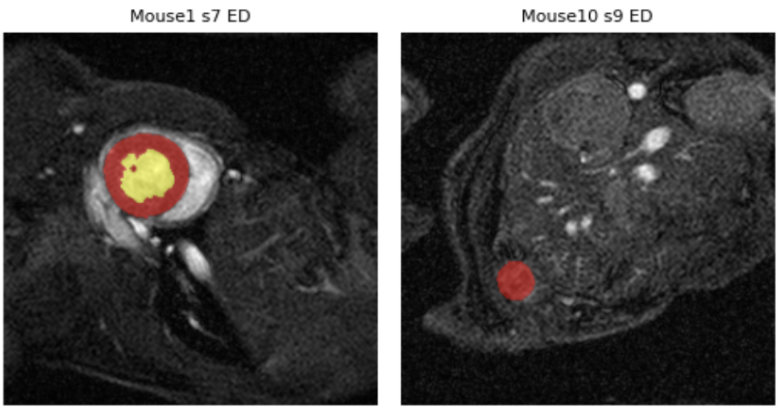
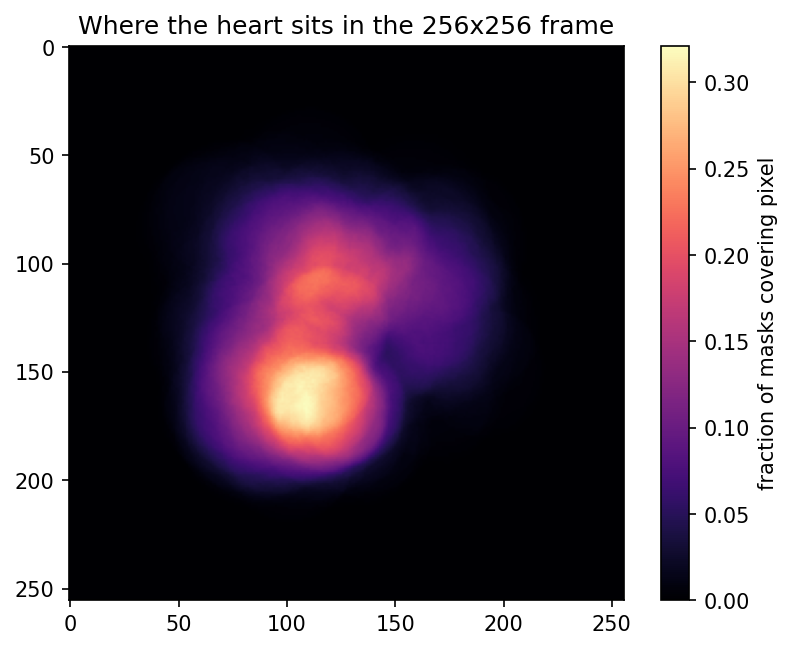
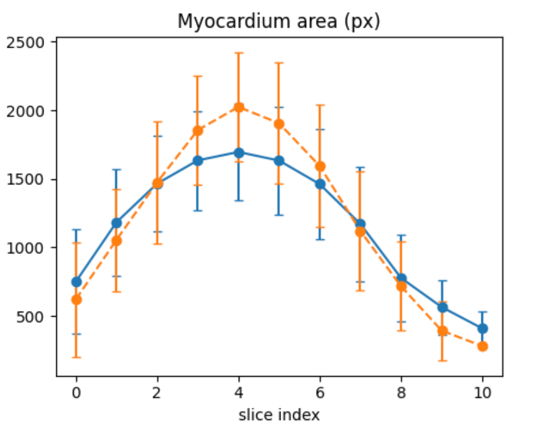

# Metadata and Data Documentation

## Data Summary

Our dataset consists of short-axis cine cardiac MRI images and expert segmentation masks from 130 mice. Each mouse has one HDF5 file containing MRI images, corresponding segmentation masks, and an indicator identifying annotated cardiac timeframes [3]. Saved outputs in our EDA notebook report 130 files, image dimensions of 256 x 256 pixels, 8-11 slices per mouse, and 17-36 cardiac timeframes [8]. Each model input will be a two-dimensional MRI slice, and its target mask will identify background, left ventricular myocardium, and blood pool. We will divide the dataset by mouse to prevent correlated images from appearing in the training, validation, and testing subsets.

## Provenance

The dataset was collected and released by Shah et al. for their study of automated mouse cardiac MRI segmentation [2]. It is publicly distributed through the mrphys/Open-Source_Pre-Clinical_Segmentation GitHub repository, which also provides the U-Net 3+ implementation and trained weights [3]. We will obtain the source files from this repository, record the version used, and preserve each processed image’s mouse identifier, slice index, and timeframe index so our preparation procedure remains traceable and reproducible. 

## License

The Open-Source Pre-Clinical Segmentation GitHub repository is distributed under the GNU General Public License version 3.0 (GPL-3.0) [2]. This license permits use, modification, and redistribution of covered materials subject to its terms, including applicable attribution and source-distribution requirements. Our project will use the repository for academic research, acknowledge the original authors, and comply with the applicable licensing conditions. We will confirm whether any separate licensing restrictions apply to the MRI dataset before redistributing its files.

## Ethical Statements 

Our project uses existing mouse cardiac MRI data and does not involve new animal experiments or human participant information. We will acknowledge the original researchers’ data collection and animal research oversight. We will report exclusions, preprocessing decisions, and model limitations transparently, and we will not present automated segmentations as substitutes for expert assessment without additional validation. 

## Data Dictionary

| Feature | Type | Description | Notes |
| :--- | :--- | :--- | :--- |
| Images | Float array, `256 × 256 × slices × timeframes` | Bright-field cine SAX image intensities. Each mouse has 8–11 slices and 17–36 timeframes. | Intensities are in arbitrary scanner units that vary between mice, so they must be normalized. |
| Masks | Integer array, same shape as `Images` | Pixel labels: background (0), LV myocardium (1), LV blood pool (2). | Expert manual tracing, so boundary pixels carry inter-observer uncertainty. This matters most for the thin mouse myocardium, where a 1–2 pixel shift substantially changes Dice. |
| Frames_with_ROI | Integer index list | Identifies which cardiac timeframes contain expert segmentation. | Unlabeled timeframes contain only zeros in `Masks`. |
| `mouse_id` (derived) | String | Taken from the `.h5` file name. | Used for splitting only, never as a model input. |
| `slice_idx`, `frame_idx` (derived) | Integer | Position of each extracted 2D slice. | Apical and basal slices may contain little or no LV. |
| `split` (derived) | `train` / `val` / `test` | Mouse-level assignment actually used for U-Net training. | Saved in `OUTPUT/UNet2D_2026-11-16_17-16-24/split.json`; 90 train / 15 validation / 25 test mice; do not replace it after training. |

## Exploratory Plots

Figure 1. Above is a sample image of a mouse left ventricle in which the yellow section represents the blood pool mass and the red section depicts the myocardium mass. 

Figure 2. This figure shows the different places where the heart sits in each image. The frame for the images is 256 x 256. This plot helps us get an understanding of what we can expect from our dataset. 

Figure 3. The figure outlines the mean left ventricular myocardium area by short-axis slice index for end-diastole (blue, solid) and end-systole (orange, dashed) across 130 mice. Error bars show ±1 SD. Area peaks at mid-ventricular slices or index 4 and falls toward both ends, with large between-mouse variability at every slice.

## References 

[1] C. Chen et al., “Deep learning for cardiac image segmentation: A review,” Front. Cardiovasc. Med., vol. 7, Art. no. 25, 2020, doi: 10.3389/fcvm.2020.00025.

[2] W. Shah et al., “Open-source pre-clinical image segmentation: Mouse cardiac magnetic resonance imaging datasets with a deep learning segmentation framework,” J. Cardiovasc. Magn. Reson., vol. 28, no. 1, Art. no. 102706, 2026, doi: 10.1016/j.jocmr.2026.102706.

[3] mrphys, “Open-Source_Pre-Clinical_Segmentation,” GitHub repository. Accessed: Nov. 9, 2026. [Online]. Available: GitHub repository.

[4] O. Ronneberger, P. Fischer, and T. Brox, “U-Net: Convolutional networks for biomedical image segmentation,” in Proc. Medical Image Computing and Computer-Assisted Intervention (MICCAI), 2015, pp. 234–241, doi: 10.1007/978-3-319-24574-4_28.

[5] H. Huang et al., “UNet 3+: A full-scale connected UNet for medical image segmentation,” in Proc. IEEE International Conference on Acoustics, Speech and Signal Processing (ICASSP), 2020, pp. 1055–1059, doi: 10.1109/ICASSP40776.2020.9053405.

[6] D. Fernández-Llaneza et al., “Towards fully automated segmentation of rat cardiac MRI by leveraging deep learning frameworks,” Sci. Rep., vol. 12, Art. no. 9193, 2022, doi: 10.1038/s41598-022-12378-z.

[7] O. Bernard et al., “Deep learning techniques for automatic MRI cardiac multi-structures segmentation and diagnosis: Is the problem solved?,” IEEE Trans. Med. Imaging, vol. 37, no. 11, pp. 2514–2525, Nov. 2018, doi: 10.1109/TMI.2018.2837502.

[8] H. Aytoda, “EDA_py.ipynb,” GitHub, 2026. [Online]. Available: https://github.com/haero-lee/DS4002-Project3/blob/main/DATA/EDA_py.ipynb. [Accessed: Nov. 11, 2026].

[9] The HDF Group, “Introduction to HDF5,” The HDF5 Field Guide. Accessed: Nov. 9, 2026. [Online]. Available: https://support.hdfgroup.org/documentation/hdf5/latest/_intro_h_d_f5.html

## Published benchmark results

[published_unet3plus.csv](published_unet3plus.csv) contains five published mean/SD rows from the [final paper, Table 1](https://pmc.ncbi.nlm.nih.gov/articles/PMC13237537/#tbl1), for the internal 9.4T cohort of 25 test mice. These summary scores were transcribed from the paper, not reproduced by this project. The CSV includes the DOI, source URL, table reference, and post-processing description.

`result_origin=published_not_reproduced` distinguishes these values from future results measured by this project. Dice values are on the 0–1 scale. ED means end-diastole; ES means end-systole. The paper used a 90/15/25 split, evaluated internal test mice at ED/ES, and applied connected-component post-processing. Its overall Dice should not automatically be treated as identical to our planned mouse-level aggregation.

The completed run uses the split saved in `../OUTPUT/UNet2D_2026-11-16_17-16-24/split.json`. Measured per-mouse scores are in that run’s `eval/test_dice_per_mouse.csv`; the generated comparison and limitations are in `analysis/`. Run `python SCRIPTS/analyze_results.py --run_dir OUTPUT/UNet2D_2026-11-16_17-16-24` from the repository root to regenerate the comparison. This re-aggregates existing scores rather than recomputing Dice from masks. It averages four class/phase scores per mouse (ED/ES × myocardium/blood pool), then gives all 25 mice equal weight. See the top-level README for protocol limitations; the comparison remains descriptive.
