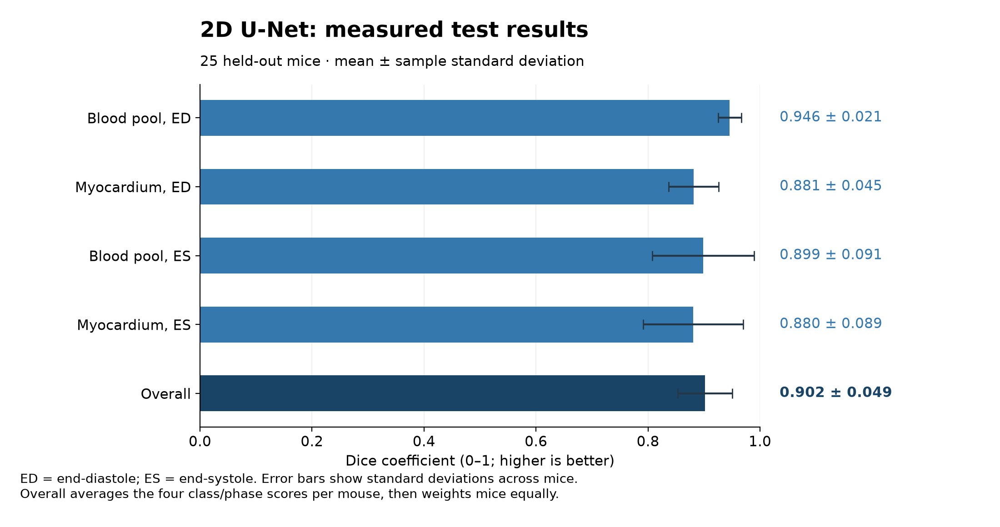
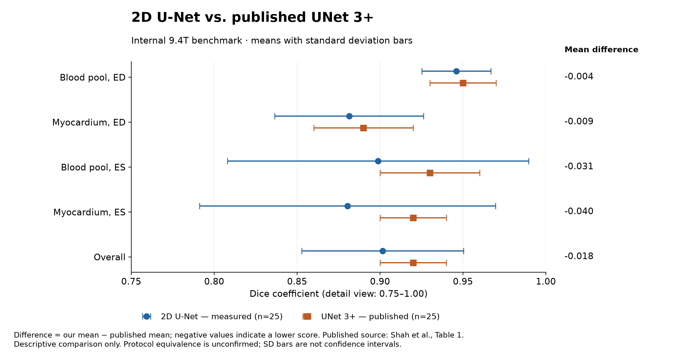

# DS4002-Project3

This project trains a standard 2D U-Net to segment the left ventricular (LV) myocardium and blood pool in mouse cardiac MRI, then compares its Dice scores with the published UNet 3+ results [1]. Our target was a mean Dice of at least 0.90 on 25 held-out test mice.

**Result:** the 2D U-Net reached a mean test Dice of **0.902 ± 0.049**, meeting the 0.90 target. Its mean Dice was slightly below the published benchmark at end-diastole and further below it at end-systole, especially for the myocardium. This is a descriptive comparison, not a test of model equivalence. We did not retrain the UNet 3+. Its scores are taken from the published paper.

## Section 1: Software and Platform

**Software**
- Python 3.11 (model training and evaluation)
- Jupyter Notebook / Google Colab (exploratory data analysis)

**Packages**

| Package | Used for |
|---|---|
| `tensorflow` (with GPU support) | Building and training the 2D U-Net |
| `h5py` | Reading the `.h5` MRI data files |
| `numpy` | Array operations |
| `albumentations`, `opencv-python` | Data augmentation during training |
| `scikit-image` | Post-processing (island removal) and cardiac phase detection |
| `matplotlib` | Training curves and figures |
| `pandas`, `scipy` | Exploratory data analysis |

Install everything with:

```bash
pip install "tensorflow[and-cuda]" h5py numpy albumentations opencv-python scikit-image matplotlib pandas scipy notebook
```

**Platform**
- Model training and evaluation: Linux workstation with an NVIDIA GPU (Epstein Lab, UVA)
- Exploratory data analysis: Mac with Python 3.12 and Google Colab

## Section 2: A Map of Our Documentation

```text
DS4002-Project3/
├── README.md
├── LICENSE
├── .gitignore                              Keeps the downloaded MRI data out of Git
├── DATA/
│   ├── README.MD                           Data provenance and dictionary
│   ├── DATA.txt                            Dataset acquisition guide
│   └── published_unet3plus.csv             Published Table 1 benchmark
├── SCRIPTS/
│   ├── 01_EDA_py_documented.ipynb          Exploratory data analysis
│   ├── 02_utility.py                       Data loading and ED/ES evaluation
│   ├── 03_train_unet2d.py                  Training and mask-level evaluation
│   ├── 04_unet2d_utils.py                  Model, training metrics, and split
│   ├── 05_analyze_results.py               Comparison from saved per-mouse scores
│   └── 06_plot_test_segmentations.py       Predicted vs. expert segmentation figures for all test mice
└── OUTPUT/
    ├── eda_outputs/                        Exploratory figures and tables
    │   ├── 01_data_sample.png
    │   ├── 02_mouse_image_quality.csv
    │   ├── 03_mouse_morphology.csv
    │   ├── 04_slice_features.csv
    │   ├── 05_step3a_flagged_masks.png
    │   ├── 06_step3a_flagged_slices.csv
    │   ├── 07_step3b_base_to_apex_profiles.png
    │   ├── 08_myocardium_plot.png
    │   ├── 09_step3b_ef_size_thickness_hists.png
    │   ├── 10_step3b_heart_location_heatmap.png
    │   ├── 11_step3c_image_quality_pca.png
    │   ├── 12_step3c_quality_outliers.csv
    │   ├── 13_step4_correlations.csv
    │   ├── 14_step8_labeled_counts.csv
    │   ├── 15_step9_area_histograms.png
    │   └── 16_step9_areas.csv
    └── UNet2D_2026-11-16_17-16-24/
        ├── config.json, split.json         Actual run settings and assignments
        ├── training_log.csv, history.json
        ├── best_model.keras, final_model.keras
        ├── loss_plot.png, dice_combined.png
        ├── eval/
        │   ├── test_dice_per_mouse.csv     Original measured scores
        │   └── test_summary.txt            Original training summary
        ├── analysis/
        │   ├── comparison_table.csv        Measured vs published scores and gaps
        │   ├── analysis_summary.txt        Recomputed statistics and limitations
        │   ├── analysis_manifest.json      Input/checkpoint hashes and environment
        │   ├── fig_unet2d_results.png      Measured Dice means and SDs
        │   └── fig_dice_comparison.png     Measured vs published scores and gaps
        └── test_segmentations/
            ├── Mouse<N>_ED_ES.png          Magnitude, ground truth, prediction, and overlap at ED and ES (one per test mouse)
            └── test_segmentation_summary.csv   ED/ES frames, labeled-slice counts, and whole-stack Dice per test mouse
```

The MRI dataset is not included. Both uploaded `.keras` model files are present in the run folder. The comparison step (`05_analyze_results.py`) produces a CSV, written explanation, and two figures from saved scores and metadata; it does not need TensorFlow, a GPU, or the MRI download. The segmentation figures (`06_plot_test_segmentations.py`) apply the saved model to the test mice, so they need TensorFlow and the MRI data.

## Section 3: Instructions for Reproducing Our Results

To compare the existing results, go directly to Step 7; do not retrain or download the MRI data. To view the model's segmentations without retraining, download the data (Steps 2–3) and go to Step 8. Steps 1–6 describe training reproduction. Every command is run in a terminal.

| Pipeline stage | Where it happens |
|---|---|
| 1. Data extraction | `03_train_unet2d.py` (Step 5 below) |
| 2. Data splitting | `03_train_unet2d.py` (Step 5) |
| 3. Preprocessing and augmentation | `03_train_unet2d.py` (Step 5) |
| 4. Model training | `03_train_unet2d.py` (Step 5) |
| 5. Evaluation on test mice | `03_train_unet2d.py` (Step 5), `05_analyze_results.py` (Step 7), and `06_plot_test_segmentations.py` (Step 8) |
| 6. Benchmark comparison | `05_analyze_results.py` (Step 7) |

### Requirements

- **Operating system:** Linux is recommended (we used a Linux lab workstation). macOS or Windows (through WSL2) can run the code, but training without an NVIDIA GPU is very slow.
- **Hardware:** an NVIDIA GPU is strongly recommended for training, which took a few hours on our lab GPU. Step 7 can run on any computer. Step 8 runs on a CPU in several minutes, or faster on a GPU.
- **Disk space:** about 6 GB.
- **Software:** [Anaconda or Miniconda](https://docs.conda.io/en/latest/miniconda.html) and Git.

### Step 1: Clone this repository

```bash
git clone https://github.com/haero-lee/DS4002-Project3.git
cd DS4002-Project3
```

### Step 2: Download the data

The data comes from the mrphys Open-Source Pre-Clinical Segmentation repository [2]. It contains cine short-axis MRI scans of 130 mice, one `.h5` file per mouse (`Mouse1.h5` to `Mouse130.h5`). Download it and move the data into `DATA/WBH5Data`:

```bash
git clone https://github.com/mrphys/Open-Source_Pre-Clinical_Segmentation.git
mv Open-Source_Pre-Clinical_Segmentation/Data DATA/WBH5Data
ls DATA/WBH5Data | wc -l     # should print 130
```

### Step 3: Set up the Python environment

```bash
conda create -n ml_env python=3.11 -y
conda activate ml_env
pip install "tensorflow[and-cuda]" h5py numpy pandas scipy albumentations opencv-python scikit-image matplotlib
```

Check that the packages installed and that TensorFlow can see the GPU:

```bash
python -c "import tensorflow as tf, h5py, albumentations, cv2, skimage; print('All imported'); print(tf.config.list_physical_devices('GPU'))"
```

You should see `All imported` followed by a GPU, such as `[PhysicalDevice(name='/physical_device:GPU:0', device_type='GPU')]`. An empty list (`[]`) means TensorFlow cannot see the GPU. Training will still run, but much more slowly.

### Step 4: Run a quick test (1 epoch)

Move into `SCRIPTS` and train for one epoch to confirm everything works. This takes a few minutes.

```bash
cd SCRIPTS
python 03_train_unet2d.py --gpu 0 --epochs 1 --data_dir ../DATA/WBH5Data --out_dir ../OUTPUT/test_run
```

Check that the output includes `Split matches the UNet 3+ paper split: YES` and `Number of training mice: 90`, `validation mice: 15`, `test mice: 25`, followed by Dice scores for 25 test mice. These scores are not meaningful. Delete `OUTPUT/test_run` afterwards.

### Step 5: Train and evaluate the model

Still in `SCRIPTS`, run the full training. `nohup` and the `&` at the end keep it running in the background after you close the terminal.

```bash
nohup python 03_train_unet2d.py --gpu 0 --epochs 300 --data_dir ../DATA/WBH5Data --out_dir ../OUTPUT > train_unet2d.log 2>&1 &
```

To check progress (press `Ctrl+C` to stop watching; training continues):

```bash
tail -f train_unet2d.log
```

This one command runs pipeline stages 1–5:

1. **Data extraction:** loads `Images`, `Masks`, and `Frames_with_ROI` from each mouse's `.h5` file. Only labeled timeframes are kept, and each is split into 2D 256 × 256 slices tagged with mouse ID, slice, and frame. Unlabeled frames are excluded, not imputed. Each mouse's end-diastolic (ED) frame is its first labeled frame, and its end-systolic (ES) frame is the labeled frame with the smallest blood pool.
2. **Data splitting:** whole mice (not slices) are split 90 / 15 / 25 into training / validation / test with seed 42. This matches the authors’ released notebook assignments [2]. Identity with the final paper’s training partition is not independently confirmed; the paper and released notebook have different labeled-image counts. Splitting by mouse prevents leakage between sets. The split is saved as `split.json`, and the test mice are not used until final evaluation.
3. **Preprocessing:** each slice is min–max scaled to [0, 1] and kept at 256 × 256. Masks are one-hot encoded into 3 channels (background, myocardium, blood pool). Training slices only are augmented with random horizontal and vertical flips, rotation (±15°), and brightness/contrast changes (±10%).
4. **Model training:**

   | Setting | Value |
   |---|---|
   | Model | 2D U-Net [3], 4 downsampling levels, 32 base filters doubling at each level (32–512), batch normalization, 3-class softmax output |
   | Loss | Soft Dice (myocardium + blood pool) + categorical cross-entropy |
   | Optimizer | Adam, learning rate 1e-4, halved when validation loss stops improving for 5 epochs |
   | Batch size | 16 |
   | Epochs | Up to 300; stops early after 10 epochs without improvement in validation Dice; the best checkpoint is kept |

5. **Evaluation:** the best model predicts every slice of each test mouse's full cine, assigning each pixel its most likely class. Small stray blobs are then removed (island removal), using the released utility code. Exact equivalence with the paper’s post-processing is not established. For each mouse, Dice is computed over the whole stack of slices at ED and at ES, separately for the myocardium and blood pool. The overall score is the mean of these four values. Results are reported as mean ± SD across the 25 test mice.

Training is finished when the log ends with `Done. Outputs saved in: ../OUTPUT/UNet2D_<date>_<time>`.

### Step 6: View the training results

The training outputs are in a new folder, `OUTPUT/UNet2D_<date>_<time>/`:

| File | Contents |
|---|---|
| `eval/test_summary.txt` | Mean ± SD test Dice and whether the 0.90 target was met |
| `eval/test_dice_per_mouse.csv` | Dice scores for each of the 25 test mice |
| `training_log.csv` | Loss and Dice for every epoch |
| `loss_plot.png`, `dice_combined.png` | Training and validation curves |
| `best_model.keras` | Trained model from the epoch with the highest validation Dice |
| `config.json`, `split.json` | Training settings and the mice in each set |

```bash
cat ../OUTPUT/UNet2D_<date>_<time>/eval/test_summary.txt
```

### Step 7: Compare the saved results with UNet 3+

From the repository root:

```bash
python -m pip install matplotlib
python SCRIPTS/05_analyze_results.py --run_dir OUTPUT/UNet2D_2026-11-16_17-16-24
```

Or, from inside `SCRIPTS`, use `--run_dir ../OUTPUT/UNet2D_2026-11-16_17-16-24`.

This script reads the original score CSV, split, config, and published benchmark. It checks unique test mice, split overlap, complete finite scores, consistency of each mouse's four-score average, and agreement with the original test summary. It recomputes means and sample SDs across equally weighted mice, then writes the comparison CSV, written summary, two figures, and input/checkpoint SHA-256 manifest into the run's `analysis/` folder. The original model, split, and evaluation files remain unchanged. The two figures require Matplotlib. Add `--no-figures` to regenerate only the CSV, summary, and manifest with the Python standard library. See the manifest for the recorded Python version and input hashes.

The CSV's difference is **our mean minus the published mean**, in Dice units. Negative values mean our point estimate is lower. The published numbers are rounded to two decimals. No between-model significance test or equivalence claim is made.

This script re-aggregates saved scores; it does not reevaluate prediction masks. The figures summarize existing scores; they are not segmentation overlays. To see the model's actual segmentations and the ED/ES frames used for each mouse, run Step 8.

### Step 8: Plot predicted vs. expert segmentations for every test mouse

This step applies the saved model (`best_model.keras`) to the 25 test mice and does not retrain anything. It needs the MRI data in `DATA/WBH5Data` (Step 2) and the packages from Step 3. From the repository root:

```bash
python SCRIPTS/06_plot_test_segmentations.py
```

The script is self-contained: the 25 test mice and the helper functions it needs are written into it, and its paths already point to the reported run and `DATA/WBH5Data`. If your files are somewhere else, edit the `CONFIGURATION` block at the top of the script. Set `GPU = "0"` there to use a GPU.

For each test mouse, it uses the same preprocessing, ED/ES selection, and island removal as the Step 5 evaluation. It predicts every slice of the ED and ES frames, then saves to `OUTPUT/UNet2D_2026-11-16_17-16-24/test_segmentations/`:

| File | Contents |
|---|---|
| `Mouse<N>_ED_ES.png` | One figure per test mouse. Rows are ED and ES at the mid-ventricular slice (the slice with the largest expert blood pool). Panels are magnitude, ground truth, prediction, and overlap. In the ground-truth and prediction panels, yellow = myocardium and green = blood pool. In the overlap panel, purple = ground truth and prediction agree, red = labeled in the ground truth but missed or given the other label, and blue = predicted where the ground truth is background. |
| `test_segmentation_summary.csv` | For each test mouse: the ED and ES frame numbers, how many slices are labeled in each, whole-stack Dice for each structure and phase, and a `partly_labeled_ES` flag |

**Check:** the whole-stack Dice values in `test_segmentation_summary.csv` should match `eval/test_dice_per_mouse.csv`. If they match, the figures show exactly what was scored.

### Comparison figures



The first figure shows our five Dice means on the full 0–1 scale, with numerical mean ± sample SD labels. Every test mouse has equal weight.



The second figure compares measured U-Net scores with the published internal 9.4T benchmark on a labeled 0.75–1.00 detail scale. The right column shows our mean minus the published mean. Error bars show standard deviations, not confidence intervals; small gaps and overlapping bars do not establish equivalence.

### Expected results

Our run stopped early at epoch 71, and the best model came from epoch 61. Our Dice is mean ± sample SD across 25 test mice; the benchmark column contains published summary values:

| Metric | 2D U-Net (ours, measured) | UNet 3+ (published [1]) |
|---|---:|---:|
| Blood pool, ED | 0.946 ± 0.021 | 0.95 ± 0.02 |
| Myocardium, ED | 0.881 ± 0.045 | 0.89 ± 0.03 |
| Blood pool, ES | 0.899 ± 0.091 | 0.93 ± 0.03 |
| Myocardium, ES | 0.880 ± 0.089 | 0.92 ± 0.02 |
| **Overall** | **0.902 ± 0.049** | **0.92 ± 0.02** |

- **Finish line met:** the mean overall Dice of 0.902 reached the ≥ 0.90 target. Individually, 17 of 25 mice reached 0.90.
- **Comparison with UNet 3+:** our mean scores were within 0.01 of the published point estimates at ED; this does not establish equivalence. The 2D U-Net scored lower at ES: 0.03 lower for the blood pool and 0.04 lower for the myocardium.
- **Best and worst mice:** the best was Mouse100 (overall 0.947), the median was Mouse78 (0.911), and the worst was Mouse91 (0.705, driven by ES Dice of 0.50–0.56). The main results include all 25 mice.
- **Partly labeled ES frames:** two test mice have extra annotated frames. For each, the ES rule selects a frame that is labeled on fewer slices than its ED frame: frame 19 of Mouse91 is labeled on 2 of 10 slices (ED: 7), and frame 11 of Mouse125 on 5 of 9 (ED: 9). On those slices, any prediction counts against Dice, even if it is correct. This likely lowers both mice's ES scores, which are among the lowest in the test set. The `partly_labeled_ES` column and the Step 8 figures show this for each mouse. The reported results still include these mice unchanged.

**Limitations:** the UNet 3+ scores are published summary values, not our own runs. Without its per-mouse scores, the models can only be compared descriptively, and no paired significance test between them is possible. Apart from the architecture, the models also differ in loss function, learning-rate schedule, and augmentation. The uploaded config lists 695 extracted labeled test images; this is not the count of ED/ES slices actually scored, whereas the paper reports 460 ED/ES test images. The EDA lists extra annotated frames for test mice Mouse91 (17 frames) and Mouse125 (11). The paper says extra inflow frames were placed in training. Verify the final-paper partition before claiming the same experiment. The utility infers ED as the earliest annotated frame and ES using minimum guarded blood-pool volume. Training did not save the chosen frames, but Step 8 records them in `test_segmentation_summary.csv`. Post-processing is enabled by default, but its on/off flag is absent from the saved config. Our overall Dice averages four class/phase scores per mouse; the paper's exact overall aggregation is not established.

**Note on reproducibility:** all random seeds are fixed (seed 42), and the data split is fully deterministic. However, TensorFlow GPU computations are not perfectly deterministic, so a rerun may stop at a slightly different epoch and give slightly different Dice scores. Results near the 0.90 threshold could change on a rerun; the reported target applies to this saved run.

### Deviations from the MI2 plan

| MI2 plan | What we did | Reason |
|---|---|---|
| 70 / 15 / 15 split (91 / 19 / 20 mice) | 90 / 15 / 25 split | Matches the released notebook lists; exact identity with the final paper partition is not independently confirmed |
| Clip intensities to the 1st–99th percentile, then rescale | Per-slice min–max scaling to [0, 1] | Matches the original authors' preprocessing (`02_utility.py`) |
| Up to 100 epochs | Up to 300 epochs | Gives early stopping more room; training stopped at epoch 71 |
| Dice over all of a mouse's labeled slices | Dice over all slices at ED and ES, with island removal | Provides ED/ES class scores for a descriptive comparison; exact protocol equivalence is not established |
| Overlay images of the best and worst cases | Overlay figures for all 25 test mice at ED and ES (Step 8) | Covers the best and worst cases and makes every test mouse inspectable |
| Limited tuning of learning rate and base filters | No tuning | The first configuration met the 0.90 target |
| Optional Wilcoxon test against the released UNet 3+ weights | Not performed; descriptive comparison against published scores only | Dropped to keep the project in scope |
| Train on Google Colab or UVA HPC | Trained on a Linux GPU workstation | A lab GPU was available |

### Troubleshooting

- **`ModuleNotFoundError`:** activate the environment (`conda activate ml_env`) and rerun the `pip install` command from Step 3.
- **`FileNotFoundError`, or 0 mice loaded:** check that the data is in `DATA/WBH5Data`. Run Steps 4–5 from inside `SCRIPTS`, and Steps 7–8 from the repository root.
- **Out of GPU memory:** add `--batch_size 8` to the training command.
- **GPU 0 is busy:** run `nvidia-smi` to see which GPUs are free, then use `--gpu 1` (or set `GPU = "1"` in `06_plot_test_segmentations.py`).
- **Stopping a running job:** find its process ID with `ps aux | grep 03_train_unet2d.py`, then run `kill <process_id>`.
## References

[1] W. Shah et al., “Open-source pre-clinical image segmentation: mouse cardiac magnetic resonance imaging datasets with a deep learning segmentation framework,” *J. Cardiovasc. Magn. Reson.*, vol. 28, no. 1, Art. no. 102706, 2026, doi: [10.1016/j.jocmr.2026.102706](https://doi.org/10.1016/j.jocmr.2026.102706). [Final paper, Table 1 and Methods](https://pmc.ncbi.nlm.nih.gov/articles/PMC13237537/).

[2] mrphys, “Open-Source_Pre-Clinical_Segmentation,” [GitHub repository](https://github.com/mrphys/Open-Source_Pre-Clinical_Segmentation). Accessed: Nov. 19, 2026.

[3] O. Ronneberger, P. Fischer, and T. Brox, “U-Net: Convolutional networks for biomedical image segmentation,” in *MICCAI*, 2015, pp. 234–241, doi: 10.1007/978-3-319-24574-4_28.
